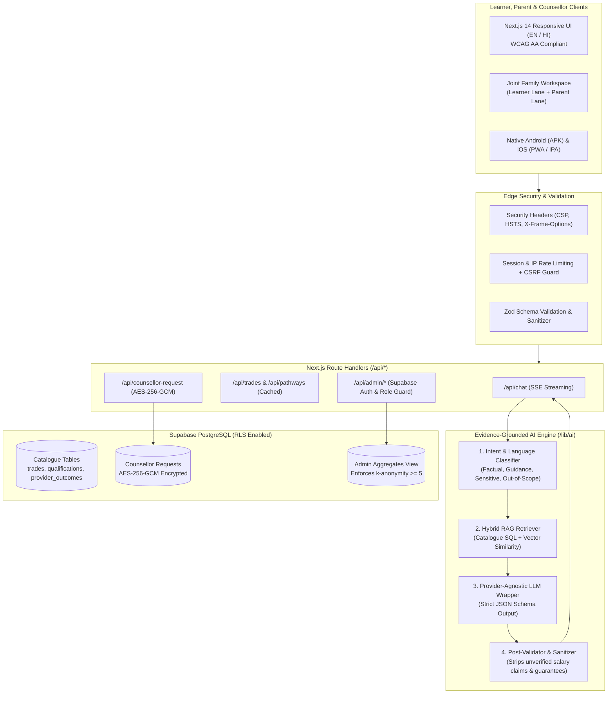

# Margdarshak AI 🧭 (मार्गदर्शक AI 2.0)
### National AI-Enabled Career Guidance, Family Financial Fit & Employability Intelligence Platform
**Smart India Hackathon 2026 (SIH) • Problem Statement SIH26241 • Ministry of Skill Development and Entrepreneurship (MSDE)**

[](https://opensource.org/licenses/MIT)
[](https://www.sih.gov.in/)
[](#-mobile-app-downloads--installers)
[-black.svg)](https://nextjs.org/)
[](https://supabase.com/)
[](#-bilingual--regional-language-inclusion)

> **"The national crisis in career progression is not merely picking a stream—it is continuously synchronizing student aptitude, household financial constraints, market demand, and verifiable skill credentials until the youth achieves sustained employability."**

---

## 📑 Table of Contents
1. [🏆 The National Challenge & Pitch Deck](#-the-national-challenge--pitch-deck)
2. [💡 Core Platform Innovation Pillars](#-core-platform-innovation-pillars)
3. [📱 Mobile App Downloads & Installers](#-mobile-app-downloads--installers)
4. [🏗️ System Architecture & AI Pipeline](#-system-architecture--ai-pipeline)
5. [📂 Repository Structure](#-repository-structure)
6. [🚀 Quick Start & Installation](#-quick-start--installation)
   - [A. Web Development (Next.js 14 & Supabase)](#a-web-development-nextjs-14--supabase)
   - [B. Interactive Single-Page Prototype (Vite)](#b-interactive-single-page-prototype-vite)
   - [C. Local Wi-Fi Download Server & Portal](#c-local-wi-fi-download-server--portal)
   - [D. Android Native App (Android Studio)](#d-android-native-app-android-studio)
   - [E. iOS Native App (Xcode)](#e-ios-native-app-xcode)
7. [🔒 Security, Privacy & Anti-Hallucination Guardrails](#-security-privacy--anti-hallucination-guardrails)
8. [📊 Demonstration Data & Evidence Framework](#-demonstration-data--evidence-framework)
9. [👥 Authors & Acknowledgements](#-authors--acknowledgements)

---

## 🏆 The National Challenge & Pitch Deck

| Metric | Crisis Point | Authoritative Evidence & National Consequence |
|---|---|---|
| **~2 in 5** | **Career–Skill Mismatch** | Nearly 40% of technically certified Indian youth work in occupations unrelated to their training (*ILO India Employment Report 2024*). |
| **38%** | **Financial Dropout Barrier** | Insufficient household budget and unexpected education costs cause 38% of post-matric dropouts (*World Bank 2022–23*). |
| **45.2%** | **Employability Gap** | Over 45% of college graduates fall below standard industry hiring criteria (*Ministry of Education / ISR 2025*). |
| **>12 Mo** | **First Job Search Delay** | Average waiting period for rural and semi-urban graduates seeking formal employment exceeds 1 year (*ILO 2024*). |
| **60.7M** | **NEET Youth Population** | 23.6% youth rate represents 60.7 million youth Not in Education, Employment, or Training (*UNICEF Gen-U 2024*). |

---

## 💡 Core Platform Innovation Pillars

### 1. Joint Family Decision Workspace (`/counselling`)
- **Dual Perspective Lanes**: Dedicated **Learner Lane** (curiosity, passions, tech interests) alongside a **Parent Lane** (earning stability, course expenses, social respect).
- **Family Financial Fit & Budget Calibration**: Real-time comparison between degree fees, hostel costs, and household budget with central/state scholarship auto-matching (NSP, Pragati, Post-Matric).
- **Downloadable Family Summary**: Generates a bilingual PDF report aligning student aspirations with parental peace of mind.

### 2. Multi-Factor Career Probability Engine
- Blends individual psychometric aptitude, regional hiring trends, competition density, and NSQF levels.
- Provides probabilistic outcome ranges instead of unrealistic promises or generic career lists.

### 3. Vocational & NSQF Progression Pathways (`/explore-trades` & `/pathways`)
- Full mapping of National Skills Qualification Framework (NSQF Level 3 through Level 6+).
- ITI, NCVT, and Polytechnic progression tracks with side-by-side trade comparison.
- Strict data integrity badges: `Verified`, `Estimate`, `Illustrative`, or `Unavailable`.

### 4. Job Seeker & Working Professional Acceleration Suite
- **AI ATS Resume Builder**: Real-time scoring out of 100 with keyword recommendations calibrated for Indian enterprise hiring ATS systems.
- **AI Mock Interview Simulator**: Contextual technical and behavioral questions with speech evaluation and confidence scoring.
- **Multilingual Communication Lab**: Soft skill modules and vocabulary drills in English, Hindi, Marathi, and Tamil.

### 5. Govt Exam Roadmaps with Automated "Plan B"
- Structured stage-by-stage syllabi for UPSC, SSC, and Banking exams.
- Built-in private-sector skill bridges ("Plan B") to prevent multi-year employment vacuums in case of competitive exam delays.

### 6. Human Counsellor Escalation Layer (`/request-counsellor`)
- Transparent fallback when questions involve severe family distress, illegal debt, or unrealistic guarantees.
- AES-256-GCM encrypted callback scheduling with verified government counsellors.

---

## 📱 Mobile App Downloads & Installers

Margdarshak provides production-grade builds for mobile devices across Android and iOS:

### 🤖 Android (Direct APK & Project)
* **Direct APK Download**: [`margdarshak-apk-installer/margdarshak.apk`](./margdarshak-apk-installer/margdarshak.apk) (or [`margdarshak-apk-installer.zip`](./margdarshak-apk-installer.zip))
* **Raw GitHub Download Link**:
  ```
  https://github.com/anshtomar-18/margdarshak-ai/raw/main/margdarshak-apk-installer/margdarshak.apk
  ```
* **Installation**:
  1. Transfer or download `margdarshak.apk` onto your Android phone.
  2. Tap the file in your notification bar or Files app.
  3. If Google Play Protect displays *"Unrecognized developer"*, tap **More details** $\rightarrow$ **Install anyway**.
* **Source Code**: Full Android Studio project located at [`margdarshak-android-project/`](./margdarshak-android-project/).

### 🍎 Apple iOS (iPhone & iPad)
* **Method 1 (Instant Home Screen App — No Mac / No Apple ID Needed)**:
  1. Open [`margdarshak-ios-installer/Margdarshak-iOS-App.html`](./margdarshak-ios-installer/Margdarshak-iOS-App.html) in Safari on your iPhone/iPad.
  2. Tap the Safari Share button (**`⎋`** or **`[↑]`**) at the bottom.
  3. Tap **"Add to Home Screen"** $\rightarrow$ **"Add"**.
  4. The app runs offline in full-screen mode with custom Deep Teal & Saffron app icons.
* **Method 2 (Apple WebClip Profile)**:
  Download and install [`margdarshak-ios-installer/Margdarshak-iOS-WebClip.mobileconfig`](./margdarshak-ios-installer/Margdarshak-iOS-WebClip.mobileconfig) via iOS Settings.
* **Method 3 (Native IPA & Xcode)**:
  - Sideload [`margdarshak-ios-installer/Margdarshak.ipa`](./margdarshak-ios-installer/Margdarshak.ipa) via AltStore / Sideloadly.
  - Or open [`margdarshak-ios-xcode-project/`](./margdarshak-ios-xcode-project/) in Xcode on macOS and deploy directly.

### 🌐 Live Download Hub & QR Portal
* Open [`download.html`](./download.html) in your browser or launch [`start-download-portal.bat`](./start-download-portal.bat).
* It dynamically computes your local network IP and presents an interactive QR code you can scan with any smartphone camera to immediately install the app over Wi-Fi.

---

## 🏗️ System Architecture & AI Pipeline



---

## 📂 Repository Structure

```text
margdarshak-ai/
├── README.md                               # Primary documentation and SIH pitch
├── index.html                              # Standalone interactive web prototype (Vite)
├── download.html                           # Mobile download hub with real-time QR generator
├── start-download-portal.bat               # 1-click Windows batch launcher for Wi-Fi download server
├── package.json                            # Root web dependencies (Vite, Tailwind)
│
├── margdarshak-apk-installer/              # Android distribution bundle
│   ├── margdarshak.apk                     # Ready-to-install Android package (713 KB)
│   └── INSTALL_ON_ANDROID.txt              # Detailed Android installation manual
│
├── margdarshak-android-project/            # Full Android Studio native project
│   └── margdarshak-android/
│       ├── app/src/main/                   # Java sources, AndroidManifest, assets
│       ├── build.gradle                    # Gradle build scripts
│       └── release/margdarshak.apk         # Compiled release binary
│
├── margdarshak-ios-installer/              # iOS distribution bundle
│   ├── Margdarshak-iOS-App.html            # Standalone offline iOS Safari web app
│   ├── Margdarshak-iOS-WebClip.mobileconfig# iOS configuration profile
│   ├── Margdarshak.ipa                     # iOS application archive (.ipa)
│   ├── INSTALL_ON_IOS.txt                  # Comprehensive iOS installation manual
│   └── ota-deployment/manifest.plist       # Enterprise Over-The-Air deployment plist
│
├── margdarshak-ios-xcode-project/          # Full Xcode project for macOS deployment
│   └── margdarshak-ios/
│       ├── Margdarshak/                    # Swift view controllers, Info.plist, AppIcons
│       ├── capacitor.config.json           # Native bridge configuration
│       └── README_XCODE.md                 # Mac build & signing instructions
│
└── supa base and the base/
    └── margdarshak-nextjs-sih26241/        # Production Next.js 14 full-stack platform
        ├── app/                            # App Router pages (/counselling, /explore-trades, /admin)
        ├── components/                     # Bilingual UI components (EvidenceBadge, FloatingAiAssistant)
        ├── docs/                           # System architecture & ER database diagrams
        ├── lib/                            # AI pipeline, AES encryption, rate limiter, validation
        ├── messages/                       # i18n dictionaries (en.json, hi.json)
        ├── supabase/                       # SQL migrations (001_schema_rls.sql) and seed data
        ├── tests/                          # E2E Playwright specs and unit test suites
        └── package.json                    # Next.js 14, Tailwind, Supabase dependencies
```

---

## 🚀 Quick Start & Installation

### A. Web Development (Next.js 14 & Supabase)
To run the full-stack production application with Supabase integration:

```bash
# Navigate to the Next.js project
cd "supa base and the base/margdarshak-nextjs-sih26241"

# Install dependencies
npm install

# Setup environment variables
cp .env.example .env.local
```

Set the required environment keys in `.env.local`:
```env
NEXT_PUBLIC_SUPABASE_URL=https://your-project.supabase.co
NEXT_PUBLIC_SUPABASE_ANON_KEY=your-anon-key
SUPABASE_SERVICE_ROLE_KEY=your-service-role-key
AI_API_KEY=your-ai-api-key
CONTACT_ENCRYPTION_KEY_HEX=your-64-character-hex-encryption-key
```

Apply database migrations:
```bash
npx supabase db push
psql $DATABASE_URL -f supabase/seed.sql
```

Start the Next.js development server:
```bash
npm run dev
# Visit http://localhost:3000
```

---

### B. Interactive Single-Page Prototype (Vite)
To run the lightweight root demonstration app:

```bash
# In the root repository directory
npm install
npm run dev
# Visit http://localhost:5173
```

---

### C. Local Wi-Fi Download Server & Portal
To serve the Android APK and iOS installer directly to devices connected on your local Wi-Fi:

* **Windows**: Double-click [`start-download-portal.bat`](./start-download-portal.bat)
* **Linux / Mac**:
  ```bash
  python3 -m http.server 8080
  ```
Open `http://<YOUR_LOCAL_IP>:8080/download.html` on your mobile device or scan the QR code displayed on your PC screen.

---

### D. Android Native App (Android Studio)
1. Open Android Studio.
2. Select **Open** and choose [`margdarshak-android-project/margdarshak-android/`](./margdarshak-android-project/margdarshak-android/).
3. Sync Gradle dependencies.
4. Connect an Android phone via USB (with Developer Options enabled) or start an emulator.
5. Click **Run** (`Shift + F10`) to build and deploy.

---

### E. iOS Native App (Xcode)
1. On a Mac, open Xcode.
2. Select **Open Existing Project** and navigate to [`margdarshak-ios-xcode-project/margdarshak-ios/`](./margdarshak-ios-xcode-project/margdarshak-ios/).
3. Under **Signing & Capabilities**, select your Personal Team (free Apple ID supported).
4. Connect your iPhone via USB and press `Cmd + R` to run.

---

## 🔒 Security, Privacy & Anti-Hallucination Guardrails

1. **Strict Post-Validation Layer**:
   AI responses pass through a regex and schema sanitization filter that automatically strips unsubstantiated salary guarantees or unverified institutional claims before reaching the student.
2. **AES-256-GCM Contact Encryption**:
   Student contact phone numbers and guardian information submitted through `/request-counsellor` are encrypted with AES-256-GCM before storage.
3. **Row-Level Security (RLS)**:
   All Supabase PostgreSQL tables enforce RLS policies preventing unauthorized reads of student concern logs or private callback data.
4. **k-Anonymity Administrator Safeguard**:
   The administrative dashboard (`/admin`) aggregates session queries with strict group suppression: any query category with fewer than $k = 5$ interactions is filtered out to prevent student de-anonymization.

---

## 📊 Demonstration Data & Evidence Framework

Every single data point displayed in Margdarshak displays an authoritative **Evidence Badge**:

| Badge | Meaning | System Behaviour |
|---|---|---|
| 🟢 **Verified** | Official government data (NCVET, PMKVY, NSDC) | Traceable reference link to official source portal. |
| 🟡 **Estimate** | Statistically derived outcome range | Confidence interval clearly stated with methodology. |
| 🔵 **Illustrative** | Mock data used for SIH demonstration | Explicit banner informing users of simulated numbers. |
| 🔴 **Unavailable** | Insufficient or unverified records | AI refuses speculation and advises speaking to a human counsellor. |

---

## 👥 Authors & Acknowledgements

* **Lead Architect & Developer**: **Ansh Tomar** ([@anshtomar-18](https://github.com/anshtomar-18))
* **Event**: **Smart India Hackathon (SIH 2026)**
* **Problem Statement**: **SIH26241** — *AI-Enabled Career Counselling & Decision-Support System*
* **Nodal Ministry**: **Ministry of Skill Development and Entrepreneurship (MSDE)**, Government of India.

---
*Built with dedication to empower India's youth and families with evidence-based, accessible, and compassionate career guidance.*
